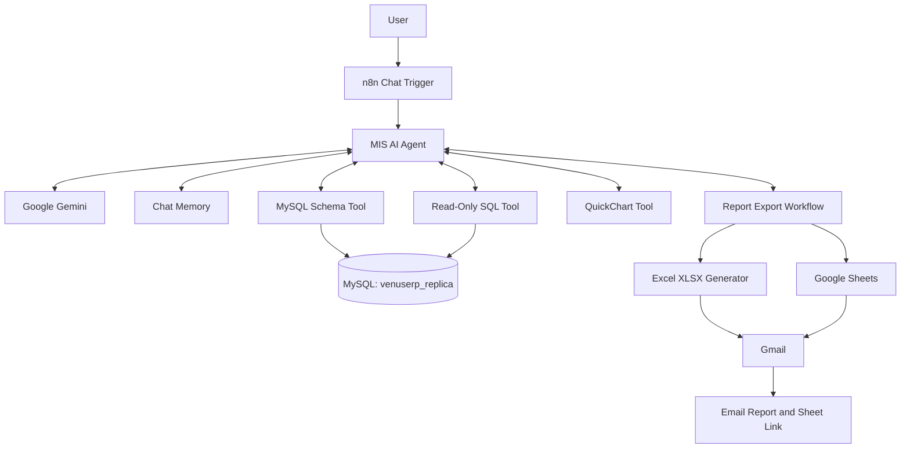

# Venus_Chatbot


**AI-powered Manufacturing MIS & Production Analytics for Venus Pipes and Tubes**

An AI-powered chatbot built with **n8n, MySQL, Google Gemini, Google Sheets, and Gmail** that enables management teams to query production data, analyze manufacturing performance, visualize trends, and export reports using natural language.

The chatbot reads approved production views from the `venuserp_replica` MySQL database and helps users turn manufacturing data into actionable business insights without writing SQL manually.

---

## Table of Contents

* [Overview](#overview)
* [Key Features](#key-features)
* [System Architecture](#system-architecture)
* [Approved Database Views](#approved-database-views)
* [Technology Stack](#technology-stack)
* [Prerequisites](#prerequisites)
* [Installation and Setup](#installation-and-setup)
* [Database Configuration](#database-configuration)
* [Example Questions](#example-questions)
* [Report Generation](#report-generation)
* [Security and Data Protection](#security-and-data-protection)
* [Troubleshooting](#troubleshooting)
* [Known Limitations](#known-limitations)
* [Future Enhancements](#future-enhancements)
* [License](#license)

## Overview

The Venus MIS Chatbot provides a conversational interface for accessing manufacturing and production information.

Instead of manually preparing SQL queries, Excel reports, or charts, users can ask questions in plain English. The AI agent identifies the relevant database views, retrieves data through controlled MySQL tools, and presents the results in a useful format.

The system is designed to support production monitoring, scrap analysis, job-card reporting, monthly performance reviews, and management decision-making.

**Primary objectives:**

* Simplify access to production MIS data.
* Reduce manual reporting and repetitive SQL work.
* Identify production trends and potential operational issues.
* Generate downloadable Excel reports and Google Sheets.
* Deliver reports through email.
* Provide a foundation for AI-assisted manufacturing analytics.

## Key Features

### 1. Natural Language Database Queries

Ask questions about production and scrap data without manually writing SQL.

Examples:

* What was yesterday's production quantity?
* Which job cards generated the highest scrap?
* Compare tubing production month by month.
* Show the production trend for the current financial year.

The AI agent uses database schema information to identify valid columns and constructs queries for the approved views.

### 2. Controlled MySQL Access

The chatbot is configured to use eight approved production views.

* Retrieves real column names before querying.
* Restricts intended queries to read-only `SELECT` statements.
* Uses a configurable row limit to help prevent unnecessarily large results.
* Separates schema discovery from data retrieval.

**Important:** Prompt instructions are not a security boundary. Enforce read-only access through MySQL permissions and validate generated SQL independently.

### 3. Interactive Chart Generation

The chatbot can generate chart images using QuickChart.

Supported chart types:

* Bar charts for production comparisons.
* Line charts for monthly and daily trends.
* Pie charts for proportional analysis.
* Doughnut charts for category distribution.

Charts can help management identify changing production levels, scrap patterns, and differences between manufacturing categories.

### 4. Automated Excel and Google Sheets Reports

The report export workflow is designed to:

1. Receive a report request and its data.
2. Parse the returned rows.
3. Create a new Google Spreadsheet.
4. Append report data to the spreadsheet.
5. Build an Excel `.xlsx` file.
6. Email the Excel attachment and Google Sheets link.
7. Return the export result to the chatbot.

The chatbot can request an email address when it needs a destination for the report.

### 5. Conversation Memory

The workflow is configured to retain up to the last 100 messages, allowing users to ask follow-up questions.

Example:

* "Show tubing production by month."
* "Now compare it with the previous month."
* "Export that report to Excel."

Actual persistence, message counting, and memory behavior depend on the configured n8n memory node.

---

## System Architecture



### Main Workflow

**File:** `Venus MIS Chatbot.json`

Responsible for:

* Receiving chat messages.
* Calling the Google Gemini model.
* Maintaining conversational context.
* Discovering database schema.
* Executing approved read-only queries.
* Generating chart images.
* Calling the report export workflow.

### Report Export Workflow

**File:** `Venus Report Export.json`

Responsible for:

* Parsing report data.
* Creating and populating a Google Spreadsheet.
* Generating the Excel workbook.
* Sending the report by email.
* Returning the execution result.

## Approved Database Views

The chatbot is intended to access only the following eight views in `venuserp_replica`.

| No. | View Name                    | Intended Reporting Area            |
| --: | ---------------------------- | ---------------------------------- |
|   1 | `VIEW_JOB_CARDWISE_PROD_PBI` | Job-card-wise production and scrap |
|   2 | `VIEW_TUBING_PBI`            | Tubing production                  |
|   3 | `VIEW_CUTTING_SCRAP_PBI`     | Cutting and scrap analysis         |
|   4 | `VIEW_LSAW_PBI`              | LSAW production                    |
|   5 | `VIEW_WELD_COND_PBI`         | Welding condition reporting        |
|   6 | `VIEW_WELDED_TUBING_PBI`     | Welded tubing production           |
|   7 | `VIEW_SLITTING_PBI`          | Slitting production                |
|   8 | `VIEW_WELDED_SCRAP_PBI`      | Welded production scrap            |

These descriptions indicate the intended reporting areas. Exact business definitions, column meanings, units, and calculations should be verified against the actual database schema and established ERP reporting rules.

## Technology Stack

| Technology        | Purpose                                             |
| ----------------- | --------------------------------------------------- |
| n8n               | Workflow automation and chatbot orchestration       |
| MySQL 8           | Production reporting database                       |
| Google Gemini     | Natural language understanding and query assistance |
| Google Sheets API | Spreadsheet creation and data export                |
| Gmail API         | Automated report delivery                           |
| QuickChart        | Chart image generation                              |
| JSON              | Workflow configuration and import/export            |

## Project Files

```text
Venus-MIS-Chatbot/
├── Venus MIS Chatbot.json
├── Venus Report Export.json
└── README.md
```

| File                       | Description                                   |
| -------------------------- | --------------------------------------------- |
| `Venus MIS Chatbot.json`   | Main AI chatbot workflow                      |
| `Venus Report Export.json` | Spreadsheet, Excel, and email export workflow |
| `README.md`                | Project documentation                         |

## Prerequisites

Before installation, ensure you have:

* An n8n instance, either cloud-hosted or self-hosted.
* A reachable MySQL server containing the `venuserp_replica` database.
* A MySQL account with appropriately restricted permissions.
* A Google Gemini API credential or supported n8n AI model connection.
* Google Sheets OAuth2 credentials.
* Gmail OAuth2 credentials.
* Network connectivity between n8n and MySQL.
* The required n8n nodes and integrations supported by the imported workflows.

Node names and credential types can differ between n8n versions. Review imported nodes for compatibility before activating the workflows.

## Installation and Setup

### Step 1: Import the Report Export Workflow

1. Open n8n.
2. Navigate to **Workflows**.
3. Select **Import from File**.
4. Import `Venus Report Export.json`.
5. Save the workflow.

### Step 2: Import the Main Chatbot

1. Import `Venus MIS Chatbot.json`.
2. Review the AI agent and all connected tool nodes.
3. Save the workflow.

### Step 3: Connect the Export Workflow

Open the `export_report` tool in the main chatbot.

Select the imported **Venus Report Export** workflow and verify that its input and output parameters match the chatbot tool configuration.

An exported workflow ID may refer to a workflow from another n8n instance. Select the correct workflow in your own environment rather than assuming the original ID will work.

### Step 4: Configure Credentials

Set up and assign the required credentials.

| Credential           | Used By                                |
| -------------------- | -------------------------------------- |
| MySQL                | `get_schema` and `run_select_query`    |
| Google Sheets OAuth2 | Spreadsheet creation and row insertion |
| Gmail OAuth2         | Email report delivery                  |
| Google Gemini        | AI chat model                          |

Use the correct credential type for each node. Credential names in the imported JSON do not automatically establish working connections.

### Step 5: Test Database Access

Verify the MySQL connection using the correct host, port, database name, username, and password.

Database name:

`venuserp_replica`

Confirm that the configured account can read the eight approved views before testing the chatbot.

### Step 6: Test the Chatbot

Open the main workflow and select **Open Chat**.

Start with a simple question:

> Show the total number of records in the job-card production view.

Then test a date-filtered production question and a report export request.

### Step 7: Test Report Export

Ask the chatbot to generate a report, provide an authorized recipient email address when requested, and verify:

* Google Spreadsheet creation.
* Correct row and column values.
* Excel file generation.
* Email delivery.
* Spreadsheet link accessibility.
* Error handling if an export step fails.

Do not activate the workflow for management use until database queries and exports have been tested end to end.

---

## Database Configuration

### Recommended Read-Only MySQL User

Create a dedicated user for the chatbot rather than using an administrator account.

The following is an example for a self-hosted n8n deployment. Replace the placeholder password with a strong secret and restrict the permitted source host instead of using `%` wherever possible.

```sql
CREATE USER 'agent_ro'@'<n8n-source-host>'
IDENTIFIED BY '<strong-unique-password>';

GRANT SELECT ON venuserp_replica.*
TO 'agent_ro'@'<n8n-source-host>';

FLUSH PRIVILEGES;
```

The example grants read access to the entire replica database. For stricter isolation, grant `SELECT` only on the eight approved views, after verifying the view definitions and required privileges.

Do not grant `INSERT`, `UPDATE`, `DELETE`, `DROP`, `ALTER`, or administrative privileges to the chatbot account.

### Restrict the Database Scope

A secure deployment should apply multiple controls:

1. Allow access only to the intended views.
2. Validate the SQL statement before execution.
3. Reject multiple statements and non-read-only operations.
4. Apply a maximum row count.
5. Set appropriate query timeouts.
6. Avoid exposing database credentials to the AI model.
7. Log query execution status without recording passwords or sensitive report contents.

A system prompt alone cannot guarantee any of these controls.

### Connecting n8n to MySQL

The host must be reachable from the machine or container running n8n.

**Self-hosted n8n:** If n8n and MySQL run in separate Docker containers on the same Docker network, use the MySQL service or container name and the database port.

**n8n Cloud:** `localhost` refers to the n8n environment, not your Windows computer. A local-only MySQL server will not be reachable without an appropriately configured secure network connection.

Possible options include a secured VPN or private network, an appropriately restricted database endpoint, or a managed tunnel with strong access controls.

Avoid exposing MySQL publicly without network restrictions, encryption, and appropriate authentication.

---

## Example Questions

### Production Monitoring

* What was yesterday's production quantity?
* Show production by month for the current financial year.
* Compare tubing production for the last two months.
* Which job cards have the highest production quantity?
* Show LSAW production by date.

### Scrap Analysis

* What was yesterday's scrap quantity?
* Show cutting scrap by job card.
* Compare scrap quantities across the available production categories.
* Which job cards have the highest scrap quantity?
* Show the monthly scrap trend.

### Management Reporting

* Prepare a monthly production summary.
* Compare production and scrap for the selected period.
* Generate a job-card-wise production Excel report.
* Create a chart showing monthly tubing production.
* Export last month's cutting scrap report and email the Excel file.

**Data accuracy note:** The chatbot must use the actual column names, valid date fields, approved units, and established ERP formulas. It should ask for clarification when a question is ambiguous or when a requested measure cannot be calculated reliably.

## Report Generation

The report export workflow is intended to produce two deliverables:

| Output              | Format        | Purpose                                   |
| ------------------- | ------------- | ----------------------------------------- |
| Spreadsheet         | Google Sheets | Online review and sharing                 |
| Downloadable report | Excel `.xlsx` | Offline analysis and distribution         |
| Notification        | Email         | Deliver the workbook and spreadsheet link |

Before production use, validate the exported data against the original MySQL query. Confirm that dates, numeric values, column headings, row counts, and totals are preserved.

The current workflow description does not establish that custom formatting, charts embedded in Excel, or a particular workbook template is implemented. Those features should be added and tested separately if required.

## Security and Data Protection

Production data can contain confidential business information. Follow these precautions:

* **Credentials:** Never commit passwords, API keys, OAuth tokens, or database connection secrets to GitHub.
* **Least privilege:** Use a dedicated read-only MySQL account.
* **SQL validation:** Enforce approved views and read-only query rules outside the AI prompt.
* **Network security:** Do not expose MySQL directly to the public internet without appropriate protections.
* **Chart privacy:** QuickChart URLs may expose labels and values to the chart service and anyone who obtains an accessible URL. Avoid sending confidential production data through public chart URLs unless approved.
* **Email privacy:** Verify recipient addresses and ensure users are authorized to receive reports.
* **Google Sheets sharing:** Configure access permissions deliberately. A generated spreadsheet link is not necessarily public, but sharing settings can expose its contents.
* **Logs and memory:** Review n8n execution logs, stored workflow data, and conversation memory for sensitive information.
* **Repository hygiene:** Inspect workflow exports before publishing them, including embedded expressions, credential references, URLs, and sample data.

## Troubleshooting

| Problem                           | Likely Cause                                            | Recommended Action                                                                     |
| --------------------------------- | ------------------------------------------------------- | -------------------------------------------------------------------------------------- |
| `Unknown database 'venus_erp'`    | Incorrect database name                                 | Use `venuserp_replica` in the MySQL credential and database nodes.                     |
| `Access denied for user`          | Incorrect password, host permissions, or missing grants | Verify the account, allowed source host, and required `SELECT` permissions.            |
| MySQL connection refused          | Incorrect host or inaccessible port                     | Test connectivity from the n8n runtime and verify MySQL network configuration.         |
| AI model returns HTTP 429         | API quota, rate limit, or billing restriction           | Check the Gemini project quota, billing status, and request rate.                      |
| Invalid column error              | AI-generated SQL uses a nonexistent field               | Run the schema tool first and verify exact column names.                               |
| No query results                  | Date filter, view data, or SQL logic may be incorrect   | Test the SQL directly against MySQL and confirm the date range.                        |
| Export workflow not found         | Incorrect or stale workflow reference                   | Select the imported export workflow in the chatbot tool configuration.                 |
| Google Sheets authorization fails | Invalid or expired OAuth credentials                    | Reauthorize the account and verify Google API access.                                  |
| Gmail delivery fails              | Invalid credentials or email restrictions               | Review the Gmail node error and verify the authorized sending account.                 |
| Chart fails to load               | Invalid chart configuration or inaccessible URL         | Validate the chart data and test the generated URL without exposing confidential data. |
| Excel report is incomplete        | Row parsing or file generation issue                    | Compare the parsed row count with the original query and inspect the export execution. |

## Known Limitations

* The chatbot depends on database availability and network connectivity.
* AI-generated SQL can be incorrect and requires independent validation.
* The meaning of terms such as "scrap," "production," "issue," and "output" must be defined using the actual ERP business rules.
* Large result sets may require aggregation, pagination, or stricter row limits.
* Google Gemini availability depends on model access, quotas, and billing configuration.
* QuickChart introduces an external data-processing dependency.
* Excel and Google Sheets output quality depends on the export workflow implementation.
* The combined workflow must be tested against live data before being considered production-ready.

## Future Enhancements

Potential improvements for future versions include:

* **Executive dashboard:** Daily production, scrap percentage, and performance indicators.
* **Financial-year analytics:** Standardized reporting for the April–March financial year.
* **Automated alerts:** Notifications when validated production or scrap thresholds are exceeded.
* **Plant and division filters:** Support for authorized entity, division, process, and job-card filters.
* **Advanced Excel formatting:** Professional report headers, number formats, totals, filters, and conditional formatting.
* **Scheduled MIS reports:** Daily, weekly, and monthly email delivery.
* **Query audit trail:** Track user questions, validated SQL, execution duration, and result counts.
* **Improved validation:** Add automated SQL allowlisting, schema checks, and query limits.
* **Business glossary:** Document approved definitions, units, and formulas for every management KPI.
* **Automated testing:** Compare chatbot totals against verified SQL results and known ERP reports.

## License

No license has been specified for this project yet.

Before publishing the repository, choose a license that matches the intended use. For example, the MIT License permits broad reuse subject to its terms, while a proprietary license can restrict redistribution and modification.

If this project is intended only for internal use at Venus Pipes and Tubes, consider keeping the repository private and adding an internal-use notice. Do not label the project as MIT-licensed unless the appropriate license text is included and that licensing decision has been approved.

---

**Project status:** Workflow design and documentation prepared. End-to-end behavior, database security, chart generation, and Excel/email export should be verified in the target n8n environment before production deployment.
